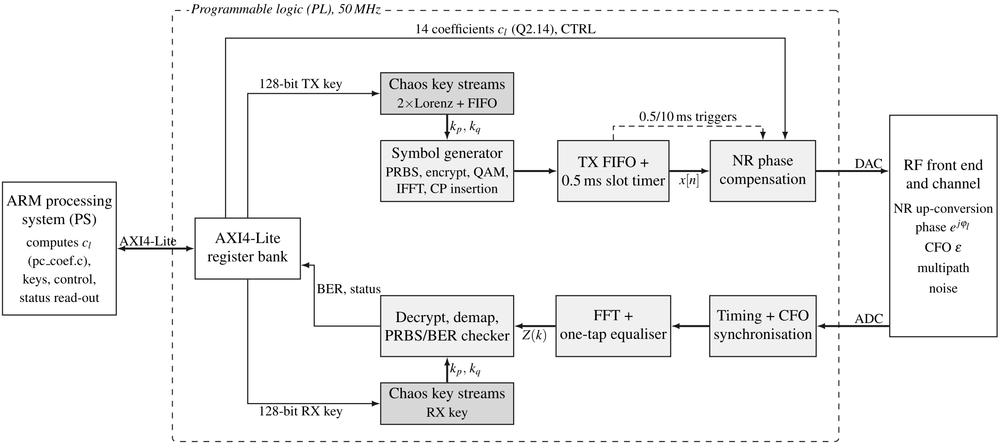
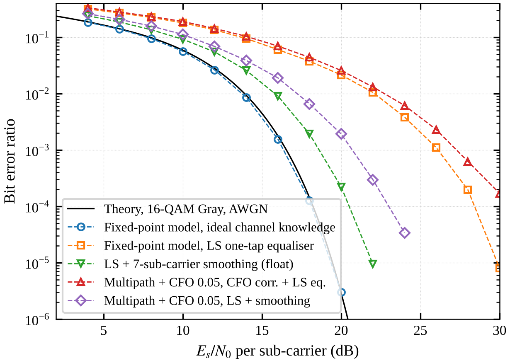
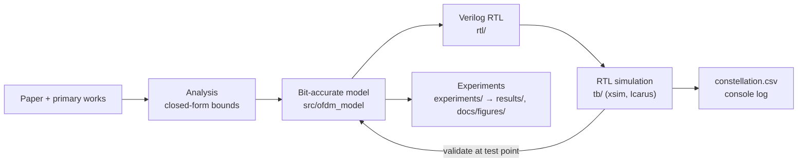

# Secure OFDM baseband on FPGA: 5G NR phase compensation, digital-chaos encryption and conjugate-symmetric synchronisation

[](https://github.com/OWNER/fpga-ofdm-secure-nr/actions/workflows/rtl.yml)
[](https://github.com/OWNER/fpga-ofdm-secure-nr/actions/workflows/python.yml)


[](LICENSE)

This repository holds a synthesizable RTL implementation of the three FPGA-OFDM techniques surveyed in Z. Tang, *"OFDM communication system based on FPGA"* (ACCTCS 2023, [doi:10.1109/ACCTCS58815.2023.00126](https://doi.org/10.1109/ACCTCS58815.2023.00126)), integrated into **one** transmitter/receiver:

- **Real-time 5G NR phase compensation.** The ARM computes 14 coefficients per slot from 3GPP TS 38.211 §5.4. Timer-generated 0.5 ms / 10 ms triggers drive a 14:1 coefficient multiplexer and a complex multiplier.
- **Physical-layer encryption with digital chaos.** Two fixed-point Lorenz generators per side, with a 128-bit key and FIFO-synchronised key streams. Data bits are XOR-masked and each 16-QAM symbol is rotated by one of 128 chaotic angles.
- **Timing and frequency synchronisation.** A conjugate-symmetric training symbol drives the paper's |P(d)|² metric, or a cheaper sign-bit metric. CFO is estimated from 14 cyclic prefixes, and a one-tap equaliser follows.

It comes with a bit-accurate Python model of the datapath, a verification environment, analytical performance bounds, and a security analysis. It is the companion repository of the M.E. thesis in [`docs/thesis`](docs/thesis/OFDM_FPGA_Thesis.pdf).



## At a glance

| | |
| --- | --- |
| FFT / CP / modulation | 128-point memory-based FFT · CP 32 (36 on symbol 0) · Gray 16-QAM |
| Frame | NR-style 0.5 ms slots of 14 symbols (2244 samples), 20 slots per 10 ms frame |
| Clock / rate | one 50 MHz clock · 4.488 MS/s · 13.3 Mbit/s payload |
| Interface | AXI4-Lite ([register map](docs/register_map.md)) · 16-bit I/Q streams |
| Code | 24 Verilog modules in 18 files (≈ 2800 lines), no vendor IP · Python model + 26 unit tests |
| Estimated cost | ≈ 70-84 DSP48E1, ≈ 83 kbit storage (analytical, not yet synthesised) |

## Key results

| Result | Value | Source |
| --- | --- | --- |
| NR phase compensation | zero bit errors with compensation on (BER 0.45 without) | RTL |
| Wrong key (1 bit of 128) | BER 0.495, EVM 26 % for the eavesdropper | RTL |
| CFO estimate for ε = 0.05 | 0.0500 | RTL |
| Fixed-point datapath vs theory | within 0.2 dB (BER 10⁻³ at 16.4 dB) | model |
| LS-equaliser penalty | 8.2 dB predicted, 9.6 dB measured; smoothing recovers about 7 dB | analysis + model |
| Updated-RTL EVM with equaliser | 3.07 %, as predicted by the LS noise enhancement | RTL + analysis |
| Key streams | 140/140 NIST-subset tests pass; ideal avalanche | model |
| **Weakness found** | per-slot key-stream reuse: 3 known slots let an eavesdropper read new slots at BER 1.3 %; fix = slot nonce | model |



> **Status.** The original RTL passed all its tests. The updated RTL in this repository passes the functional checks, but Tests 2, 5 and 6 showed residual errors, which were traced to test-procedure transitions. The two-slot-flush rerun has not been confirmed yet; see [Known issues](docs/verification.md#known-issues). Results are reported as measured.

## Repository layout

```
rtl/            synthesizable Verilog (18 files, top = ofdm_top)
tb/             system testbench, channel model, FFT unit testbench
sw/             PS (ARM) code: NR phase-compensation coefficients
constraints/    50 MHz out-of-context constraint
scripts/        sine-table generator; Vivado project / simulation / synthesis Tcl
src/ofdm_model/ bit-accurate Python model (fx, sync, chaos, plotstyle)
experiments/    Monte-Carlo experiments that produce results/ and docs/figures/
tests/          pytest unit tests (model, golden RTL values, RTL/model consistency)
results/        JSON results of the experiments; RTL constellation dump
docs/           architecture, register map, verification, methodology, results, security,
                paper alignment, roadmap, TikZ diagram sources, thesis PDF
.github/        CI, results and release workflows; issue/PR templates
```

## Quick start

```sh
git clone https://github.com/OWNER/fpga-ofdm-secure-nr.git && cd fpga-ofdm-secure-nr
pip install -e ".[dev]"          # Python model + test tools
make test                        # 26 model unit tests
make quick                       # all experiments in smoke mode (about 30 s)
make results                     # full experiments -> results/*.json, docs/figures/*.png (about 10 min)

# RTL (open-source tools)
sudo apt install iverilog verilator
make lint                        # Verilator lint
make sim-fft                     # FFT unit test
make sim-top                     # system regression -> build/tb_top.log, build/constellation.csv
python experiments/plot_rtl_constellation.py build/constellation.csv

# RTL (Vivado 2020.1+)
make vivado                      # create build/vivado/ofdm_fpga.xpr  (OFDM_PART=xc7z020clg400-1 by default)
make vivado-sim                  # run tb_ofdm_top in xsim
make synth                       # out-of-context synthesis, reports in build/reports/

# PS software
make sw                          # build and run pc_coef, check the golden coefficients
```

## Workflow



Every change goes through the same loop:

1. Change the model and add a test.
2. Change the RTL.
3. Simulate.
4. Compare the RTL with the model at the test point.
5. Regenerate the results.

### Continuous integration

| Workflow | Trigger | Jobs |
| --- | --- | --- |
| [`rtl.yml`](.github/workflows/rtl.yml) | push, PR | PS C program with golden check · Verilator lint · Icarus FFT unit test · Icarus system regression (non-blocking until confirmed; uploads log + constellation) |
| [`python.yml`](.github/workflows/python.yml) | push, PR | Python lint + 26 unit tests + experiment smoke run (3.10, 3.12) |
| [`results.yml`](.github/workflows/results.yml) | manual | full-size experiments, figures and JSON as an artifact |
| [`release.yml`](.github/workflows/release.yml) | tag `v*` | RTL bundle + thesis PDF attached to a GitHub release |

## Documentation

- [Architecture](docs/architecture.md): data flow, modules, fixed-point formats, cycle budget
- [Register map](docs/register_map.md): AXI4-Lite registers, bit fields, coefficient table, programming sequence
- [Verification](docs/verification.md): testbench, tests, how the data is extracted, RTL results, known issues
- [Methodology](docs/methodology.md): the model, analytical results, experiment setups, uncertainty
- [Results](docs/results.md): all figures with their findings
- [Security](docs/security.md): threat model, tests, key-stream reuse attack and fix
- [Paper alignment](docs/paper_alignment.md): the 34 paper-vs-RTL items and their status
- [Roadmap](docs/roadmap.md): open issues and planned enhancements
- [Thesis (PDF)](docs/thesis/OFDM_FPGA_Thesis.pdf)

## Citing

If you use this work, please cite it with [`CITATION.cff`](CITATION.cff), and cite the reference paper:

> Z. Tang, "OFDM communication system based on FPGA," in *Proc. 3rd Asia-Pacific Conf. Commun. Technol. Comput. Sci. (ACCTCS)*, 2023, pp. 666-670.

## Authors

- **Riya Das** (2025H1240213H), M.E. Communication, BITS Pilani, Hyderabad Campus: thesis author; Python models, experiments, documentation.
- **Sayantan**: repository maintainer for the hardware side (RTL, testbench, Vivado flow, RTL CI).

Supervisor: Prof. Subhendu Kr Sahoo.

## License

[MIT](LICENSE)
