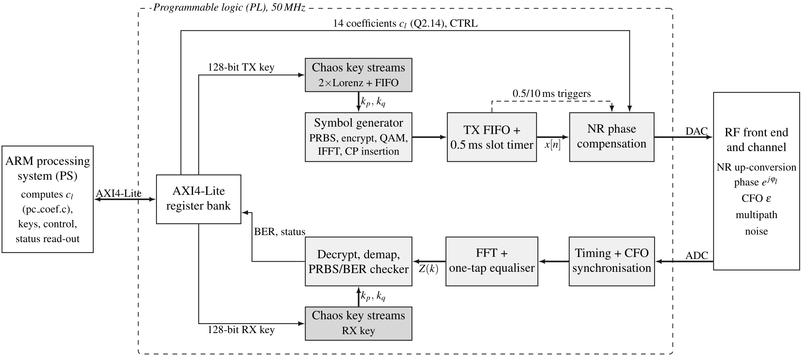
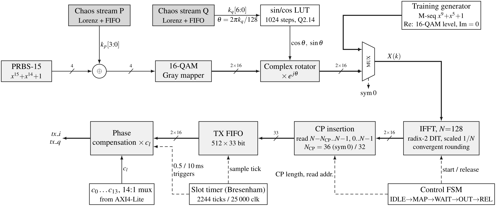
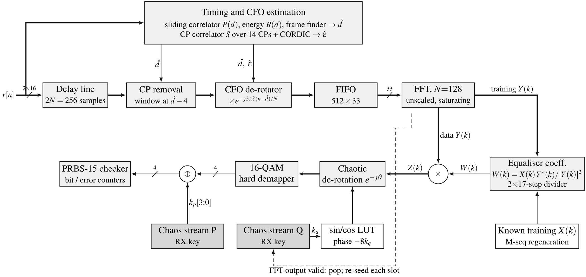
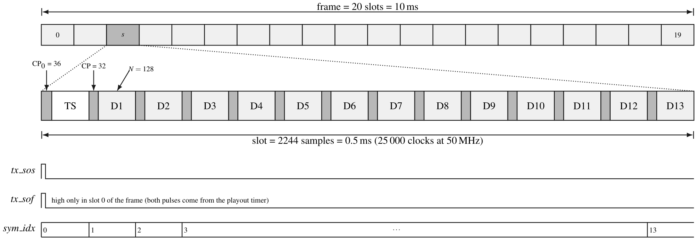

# Architecture

The design is a complete OFDM transmitter and receiver in synthesizable Verilog-2001, on one 50 MHz clock, controlled by an ARM processing system (PS) over AXI4-Lite. It uses no vendor IP, so it simulates in any Verilog simulator.

## Parameters

| Parameter | Value | Note |
| --- | --- | --- |
| FFT size N | 128 | memory-based radix-2 core |
| Cyclic prefix | 32 samples (36 on symbol 0) | NR long first-symbol CP |
| Modulation | 16-QAM, Gray, A = 2048 | levels ±2048, ±6144 |
| Symbols per slot / slots per frame | 14 / 20 | 0.5 ms slot, 10 ms frame |
| Samples per slot | 36 + 128 + 13 × 160 = 2244 | 4.488 MS/s |
| Clock | 50 MHz | 11.14 clocks per sample |
| Sample format | 16-bit two's complement I/Q | |
| Chaos key | 128 bits, two Lorenz streams per side | up to 2^120 seed states |
| Payload rate | 13 × 128 × 4 bit / 0.5 ms = 13.31 Mbit/s | 74.2 % of samples carry data |

## Data flow

```mermaid
flowchart LR
  subgraph PS["ARM processing system"]
    SW["pc_coef.c<br/>14 NR coefficients<br/>128-bit keys"]
  end
  subgraph TX["Transmitter"]
    PRBS["PRBS-15"] --> XP["XOR stream P"] --> MAP["16-QAM map"] --> ROT["rotate 2πkq/128<br/>(stream Q)"] --> IFFT["IFFT 1/N<br/>+ training sym 0"] --> CPI["CP insert"] --> RATE["tx_rate_ctrl<br/>2244 samples / 0.5 ms"] --> PC["phase_comp_core<br/>× c_l"]
  end
  subgraph RX["Receiver"]
    SYNC["timing_sync<br/>M0 / |P|² metric<br/>CP-based CFO"] --> BUF["data buffer 2N<br/>CFO de-rotation"] --> FFT["FFT"] --> EQ["one-tap LS<br/>equaliser"] --> DEC["rotate −2πkq/128<br/>demap, XOR P"] --> BER["PRBS checker<br/>BER counters"]
  end
  SW -- AXI4-Lite --> TX
  SW -- AXI4-Lite --> RX
  PC -- "channel (NR phase, CFO,<br/>multipath, noise)" --> SYNC
```

### Transmitter

- **ofdm_tx** builds one symbol at a time. Data symbols: four PRBS-15 bits per sub-carrier XOR-ed with key stream P, Gray 16-QAM mapping, rotation by θ = 2π·k_q/128 from key stream Q. Symbol 0 is the conjugate-symmetric training symbol: a 9-bit M-sequence mapped to real 16-QAM levels (imaginary part zero), so its IDFT satisfies x(N−n) = x*(n).
- **tx_rate_ctrl** buffers bursts in a 512-deep FIFO and plays them out at exactly 2244 samples per 25 000 clocks with a Bresenham accumulator. It generates the 0.5 ms slot and 10 ms frame triggers and flags underflow and misalignment.
- **phase_comp_core** tracks the symbol index of every sample from the triggers and multiplies by the ARM-computed coefficient c_l = e^(−jφ_l) (3GPP TS 38.211 §5.4).

### Receiver

- **timing_sync** (five sub-modules) computes, every sample, the sign-bit metric M0 = |Re P| + |Im P| and the paper's metric M1 = |P(d)|² on 4-bit samples, gated by the window energy. The frame finder locks 80 samples after the last new maximum and re-arms 32 samples before the next expected training. The CFO is estimated from the cyclic prefixes (28-sample ISI-free window, 14 CPs) with a 16-iteration CORDIC.
- **ts_data_buffer** delays the stream by 2N, de-rotates it by the CFO estimate and forwards CP-free windows, 4 samples early when the equaliser is on.
- **rx_equalizer** computes W(k) = X(k)Y*(k)/|Y(k)|² from the training symbol in Q4.14 with two restoring dividers.
- **ofdm_rx** equalises, decrypts, demaps and checks the PRBS (self-synchronising, 32-bit warm-up).

## Slot structure

The training symbol occupies symbol 0 of every slot, so timing, CFO, equaliser and key streams are refreshed every 0.5 ms.

## Modules

| Module | Function |
| --- | --- |
| `ofdm_top` | Top level: registers, TX, rate control, phase compensation, RX |
| `ofdm_axil_regs` | AXI4-Lite slave register bank ([register map](register_map.md)) |
| `ofdm_tx` | PRBS, encryption, QAM, training, IFFT, CP |
| `tx_rate_ctrl` | Output FIFO, sample pacing, 0.5 ms / 10 ms triggers |
| `phase_comp_core`, `cmult` | Symbol tracker, 14:1 coefficient mux, complex multiplier |
| `chaos_keystream`, `lorenz_chaos` | Two fixed-point Lorenz generators (Q12.20, dt = 2^-7) with 256-byte FIFOs |
| `fft_core`, `twiddle_rom` | Memory-based radix-2 DIT FFT/IFFT, Q2.14 twiddles, convergent rounding |
| `sincos_lut`, `cplx_rot` | 1024-step sine table (generated), complex rotator |
| `timing_sync` | Correlators, energy, CP correlator, frame finder, data buffer |
| `cordic_vec` | Iterative CORDIC, vectoring mode |
| `rx_equalizer` | Training-based one-tap equaliser |
| `ofdm_rx`, `qam16`, `sync_fifo` | Receiver chain, mapper/demapper, FIFO |

## Fixed-point formats

| Signal | Format |
| --- | --- |
| I/Q samples, FFT data | 16-bit two's complement |
| Twiddles, sine table, c_l | Q2.14 (0x4000 = 1.0) |
| Equaliser W(k) | Q4.14 (18 bits) |
| Lorenz state | Q12.20 (32 bits), 64-bit products |
| Timing correlator | 1-bit and 4-bit samples; M1 28 bits |
| CP correlator | 8-bit samples |
| CFO phase | 24-bit accumulator (turns), 10-bit table phase |

## Cycle budget at 50 MHz

| Operation | Cycles |
| --- | --- |
| Available per symbol (25 000 / 14) | ≈ 1786 |
| TX: map + IFFT (7 × 64 × 2) + CP | ≈ 1190 (67 %) |
| RX: FFT load + compute + read-out | ≈ 1150 per symbol |
| RX: equaliser coefficients | ≈ 2430 per slot |
| RX total per slot | ≈ 18 500 of 25 000 (74 %) |
