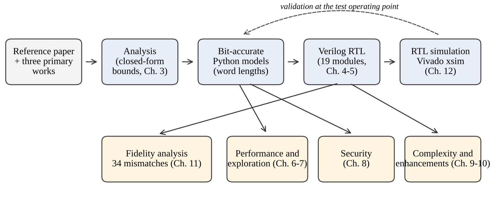

# Methodology: models, analysis and experiments

Every result in this repository comes from one of three sources:

- **RTL simulation:** Vivado xsim or Icarus, using the testbench in `tb/`.
- **Bit-accurate Python model:** `src/ofdm_model`.
- **Closed-form analysis:** used to check the other two.

## Why a model

One 0.5 ms slot takes minutes in an HDL simulator. A BER curve to 10⁻⁵ needs about 10⁶ bits per point, and a detection probability needs hundreds of trials. The model reproduces the RTL arithmetic integer by integer, vectorised over a whole slot, so these experiments take seconds.

| Model function (`fx.py`) | RTL | Fidelity |
| --- | --- | --- |
| `fft_fx` | `fft_core`, `twiddle_rom` | exact: DIT order, Q2.14 twiddles, convergent rounding, per-stage halving, saturation |
| `rot_fx` | `cplx_rot`, `sincos_lut` | exact |
| `cmult_fx` | `cmult` | exact (round by 2¹³, shift 14) |
| `tx_slot` | `ofdm_tx` | exact mapping, training, CP; random data instead of PRBS |
| `channel` | `channel_model.v` | NR phase, multipath, CFO; Gaussian noise at a chosen SNR |
| `cfo_est` | `ts_cfo_corr` + `cordic_vec` | exact 8-bit quantisation; atan2 instead of CORDIC |
| `rx_slot` | `ts_data_buffer`, `rx_equalizer`, `ofdm_rx` | exact 10-bit de-rotation, Q4.14 restoring division, 4-sample back-off |
| `sync.metrics`, `sync.finder` | `ts_sliding_corr`, `ts_frame_find` | exact quantisation, thresholds, energy gate, 80-sample hold |
| `chaos.*` | `lorenz_chaos`, `chaos_keystream` | exact (xorshift64 seeding, Q12.20 Euler, byte extraction) |

Rounding everywhere is convergent: `round(v) = (v + 2^(S−1) − 1 + v[S]) >> S`.

**Validation at the RTL test point** (38.8 dB as configured in the model; the testbench noise is 38.2 dB, see below):

| Configuration | RTL EVM | Model EVM |
| --- | --- | --- |
| No equaliser (original RTL) | 1.18 % | 1.14 % |
| LS equaliser, AWGN | 3.07 % | 2.77 % |
| LS equaliser, multipath + CFO | 3.21 % | 3.06 % |

The small gap is mostly SNR. The testbench's integer noise (−8 … +8) has variance (17² − 1)/12 = 24 and gives 38.2 dB. The model runs labelled 38.8 dB used the continuous value 8/√3.

## Analytical results

| Result | Formula | Value | Checked against |
| --- | --- | --- | --- |
| BER of Gray 16-QAM | P_b = ¼[3Q(a) + 2Q(3a) − Q(5a)], a = √(E_s/5N₀) | 10⁻³ at 16.5 dB | model within 0.2 dB |
| LS equaliser noise enhancement | EVM² = (1/SNR)(1 + E_s·E[1/\|X_t\|²]); training ±A, ±3A gives 1 + 5.56 | 6.56 = 8.2 dB, EVM × 2.56 | RTL 3.07 % vs 3.15 % predicted at 38.2 dB |
| Smoothing over M sub-carriers | EVM² ≈ (1/SNR)(1 + 5.56/M) | M = 7: 2.5 dB | model |
| Sign-bit metric peak | E[M0] ≈ 126·(2/π)·arcsin(SNR/(1+SNR)) | equals TH0 = 88 at 9.1 dB | model 50 % point ≈ 10.5 dB |
| CP CFO estimator | var(ε̂) ≈ (1/4π²L)(1/SNR + 1/(2SNR²)) | L = 392: σ = 9.2 × 10⁻⁵ | model, 8-bit quantisation adds about 1.5× |
| Residual CFO | drift 2πε·2244/128 per slot; ICI loss ≈ (10/3ln10)(πε)²·SNR | ε = 10⁻³: 6.3°, 0.1 dB | - |
| Phase error | EVM = 2\|sin(δ/2)\| | 1° gives 1.7 %; decisions fail near 17° | model |
| Carrier mismatch in the PS | δ_l = 2πΔf(t_l − t₀), t₁₃ − t₀ = 0.4635 ms | 30 Hz gives 5.0° at symbol 13 | model |

Derivations are in Appendix B of the [thesis](thesis/OFDM_FPGA_Thesis.pdf).

## Experiments

| Script | Output | Setup |
| --- | --- | --- |
| `exp_link.py` | `ber_snr`, `evm_snr`, `cfo_rmse`; `results/res_link.json` | E_s/N₀ 4-30 dB; 40-300 slots per point (≤ 2 × 10⁶ bits); five receiver configurations; CFO RMSE: 150 slots per SNR, L = 28 and 392 |
| `exp_sync.py` | `sync_pd`; `res_sync.json` | two slots per trial, 120 trials per SNR; tracking (search from −32) and acquisition (from −1500); correct = \|d̂ − d\| ≤ 2 |
| `exp_pc.py` | `pc_mismatch`; `res_pc.json` | coefficients for f0 + Δf (0, 10, 30, 100 Hz), channel at f0; 20 slots; per-symbol EVM |
| `exp_dse.py` | `timing_offset`, `cfo_range`, `wordlength`, `threshold_roc`; `res_dse.json` | window offset −40 … +8; ε ±0.45; FFT width 10-18 and twiddle 8-14 bits; correlator 4-12 bits; threshold sweeps at 9 and 15 dB |
| `exp_chaos.py` | `chaos_acf`, `chaos_sens`; `res_chaos.json` | NIST SP 800-22 subset on 10 keys × 65 536 bytes; 128 key-bit flips; Lyapunov exponent and merging on 128 pairs; Brent cycle search over 2¹⁸ steps; known-plaintext attack on 1664 positions |
| `exp_enh.py` | `enh_compare`, `gain_norm`; `res_enh.json` | 7-sub-carrier smoothing; TH0 = 76; normalised \|P\|² test over a gain of −9 … +9 dB |
| `plot_rtl_constellation.py` | `rtl_constellations` | reads an RTL `constellation.csv`, prints per-symbol EVM |

All experiments use fixed seeds. `OFDM_QUICK=1` runs about a tenth of the trials, and CI uses it.

## Statistical uncertainty

| Quantity | Sample | 1σ |
| --- | --- | --- |
| BER 10⁻³ / 10⁻⁴ | ≈ 2000 / 200 errors | ±2 % / ±7 % |
| Detection probability | 120 trials | ≤ ±0.046 |
| CFO RMSE | 150 trials | ±6 % |
| Merging fraction | 128 pairs | ±4.4 % |
