# Results

Model results come from the bit-accurate model in `src/ofdm_model`, validated against the RTL ([methodology](methodology.md)). RTL results are in [verification](verification.md). Regenerate everything with `make results`.

## Link performance

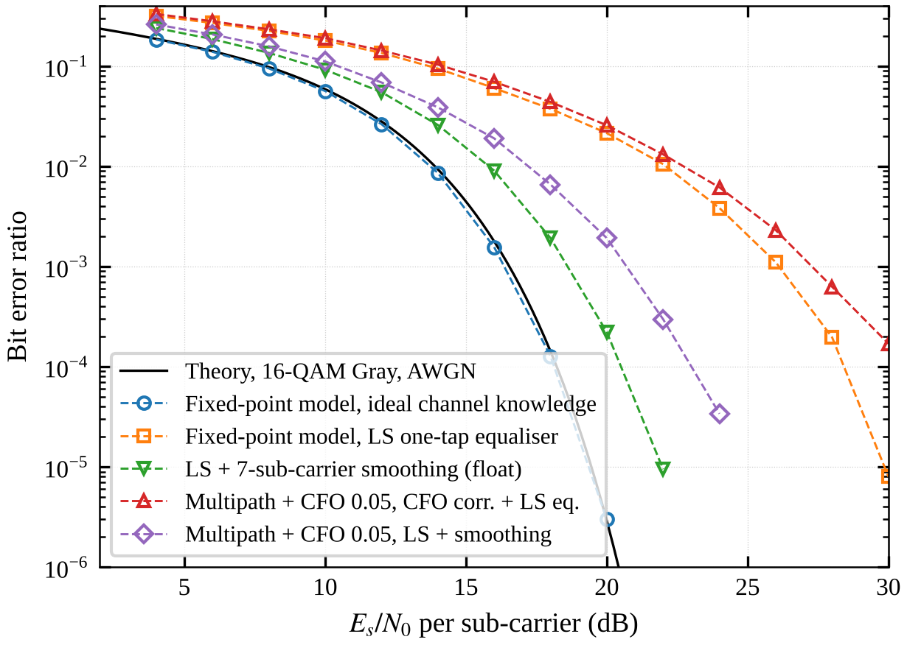

| Receiver | E_s/N₀ for BER 10⁻³ | Loss vs theory |
| --- | --- | --- |
| Theory, Gray 16-QAM | 16.5 dB | - |
| Fixed point, ideal channel knowledge | 16.4 dB | ≈ 0 |
| Fixed point, LS one-tap equaliser (as in the RTL) | 26.2 dB | 9.6 dB |
| LS + 7-sub-carrier smoothing | 18.6 dB | 2.1 dB |
| Multipath + CFO 0.05, LS (as in the RTL) | 27.3 dB | 10.7 dB |
| Multipath + CFO 0.05, LS + smoothing | 20.7 dB | 4.2 dB |

The fixed-point datapath is transparent. The single-symbol LS equaliser is the limiting block (8.2 dB predicted, 9.6 dB measured at 10⁻³).

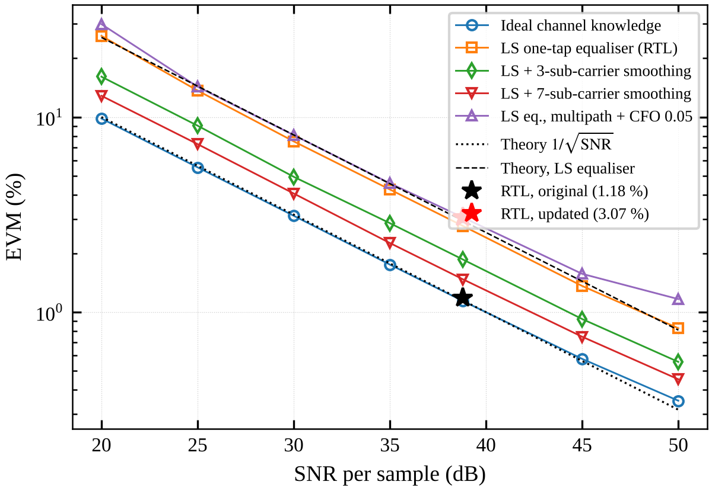

## Synchronisation

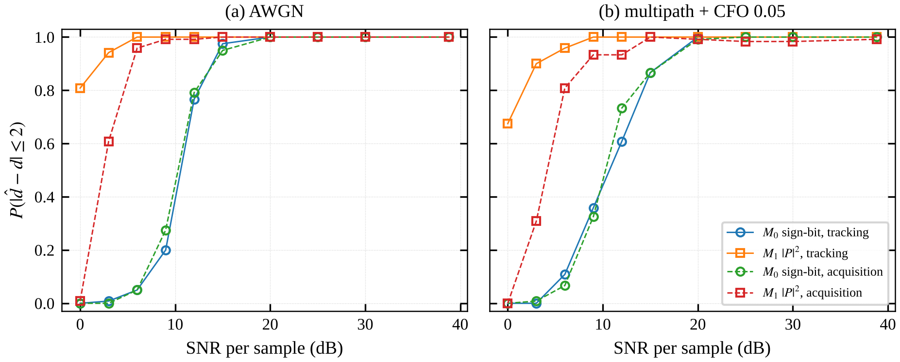

- Sign-bit metric M0: reliable from 15 dB in AWGN and 20 dB with multipath; one early lock in 4800 trials.
- Paper metric |P(d)|²: reliable from about 6 dB in tracking, but it locks falsely during acquisition and depends on the receiver gain.

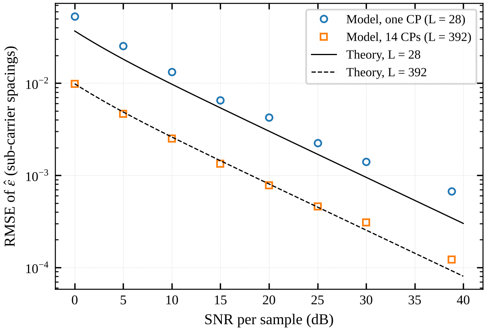

The 14-CP CFO estimator reaches 1.2 × 10⁻⁴ RMSE at the test SNR, about 0.6° of drift per slot.

## Design-space exploration

| Figure | Finding |
| --- | --- |
| 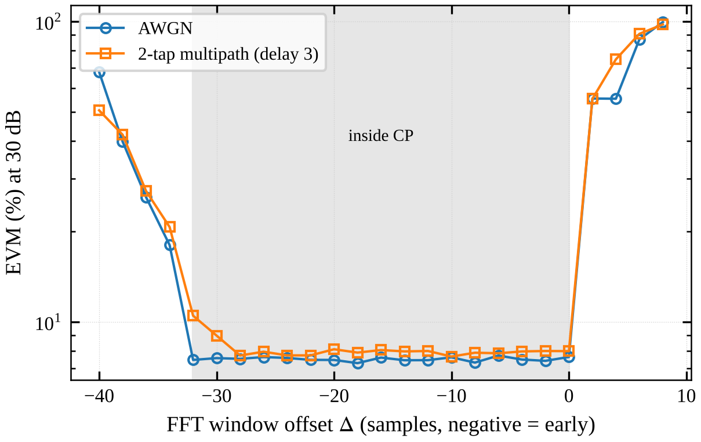 | ISI-free window −32 … 0 (AWGN), −28 … 0 (multipath); with the 4-sample back-off, lock errors of −24 … +4 are tolerated |
| 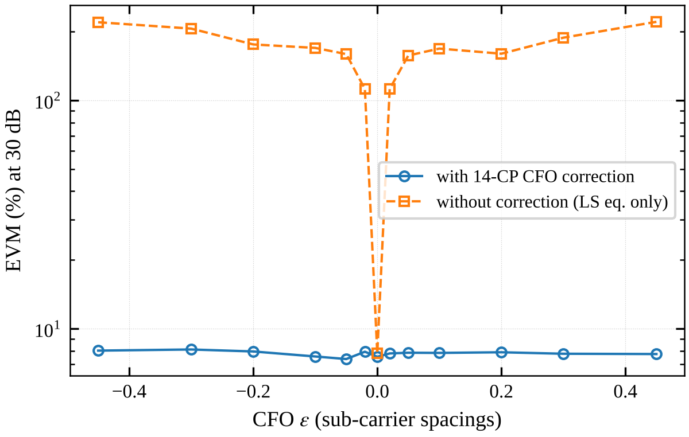 | CFO correction is essential and keeps EVM flat over \|ε\| ≤ 0.45 |
| 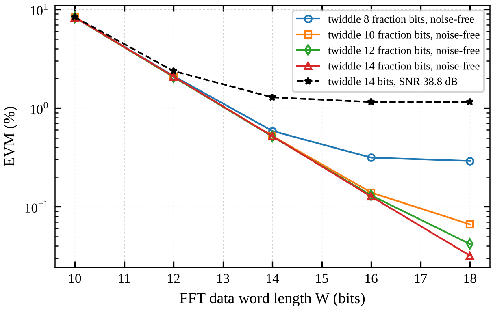 | 16-bit FFT data with Q2.14 twiddles has about 2 bits of margin; 14 / 12 bits is the minimum for 16-QAM |
| 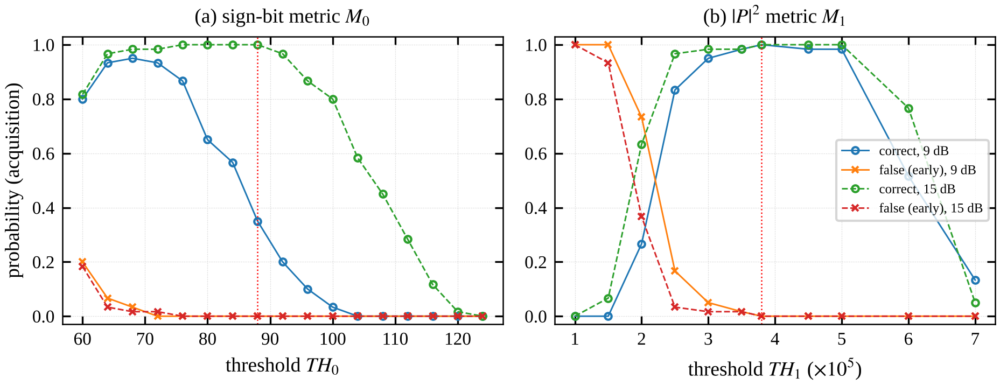 | TH0 = 88 is conservative (72-76 is better); the \|P\|² threshold window is narrow |

## Phase compensation

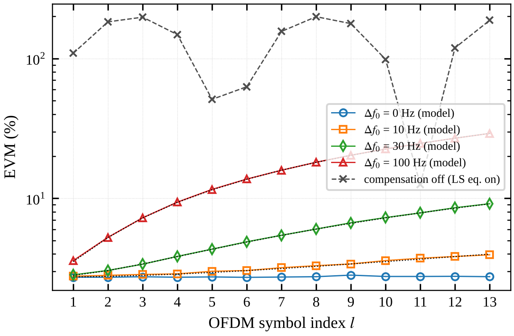

Q2.14 coefficient quantisation is negligible (< 0.004°). A carrier mismatch between the PS coefficients and the receiver of 30 Hz gives about 9 % EVM on the last symbol.

## Security

See [security](security.md).

## Proposed enhancements (model)

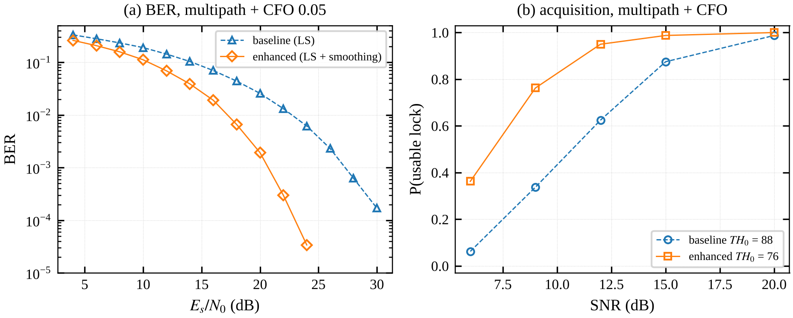
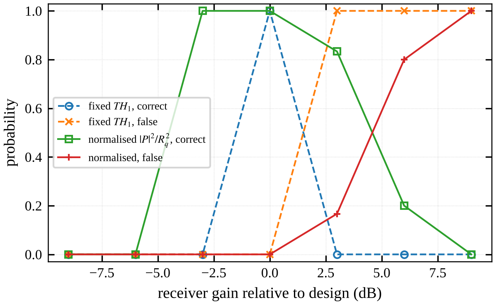
