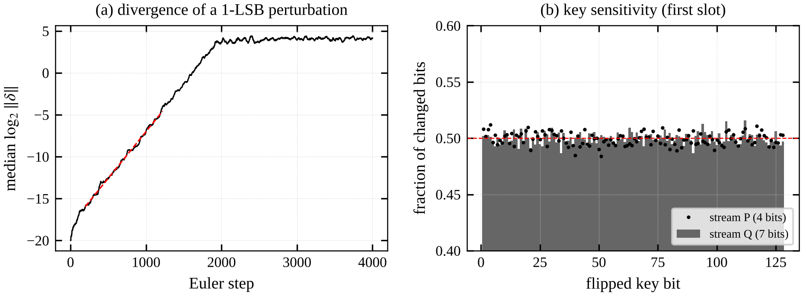

# Security analysis of the digital-chaos encryption

**Threat model:** a passive eavesdropper with an identical receiver. She knows the algorithm and all parameters except the 128-bit key (Kerckhoffs). She synchronises to the unencrypted training symbol. Two cases are considered: ciphertext only, and known plaintext.

| Property | Result | How |
| --- | --- | --- |
| Key space | 128-bit key; up to 2¹²⁰ seed states (2 × 60 bits); about 4 × 10¹⁶ years at 10¹² keys/s | counting |
| Statistical quality | 140 / 140 test instances pass at α = 0.01 | NIST SP 800-22 subset (monobit, block frequency, runs, cusum, approximate entropy, serial) + chi-square, 10 keys |
| Autocorrelation | max \|r\| = 0.0054 for lags 1-256 (bound 3/√n = 0.0059) | 262 144 bits |
| Key sensitivity | one key bit changes 48.4-51.6 % of the stream bits, from the first byte | 128 single-bit flips |
| Lyapunov exponent | 1.06 per time unit (continuous Lorenz 0.906) | 1-LSB perturbation pairs |
| Finite-precision merging | **43.75 %** of 1-LSB perturbation pairs merge into one trajectory | same pairs |
| Cycles | none within 2¹⁸ steps (32 keys) | Brent's method |
| Wrong key (RTL Test 3) | BER 0.495, EVM 26 % | RTL simulation |
| **Key-stream reuse** | streams re-seeded from the key alone every slot. After 3 known-plaintext slots, 2.11 candidates per position remain and Eve's BER on new slots is **1.26 %** (0.508 with a fresh stream) | exhaustive candidate elimination, 1664 positions |



## Countermeasure: slot nonce

Mix a 64-bit slot counter v, reset only with the key, into the seed:

```
h = xs64( xs64(K[63:0] ⊕ D ⊕ v) ⊕ K[127:64] )
```

The cost is one counter and one 64-bit XOR per generator. Recovery after a missed slot is unchanged, because each slot's seed depends only on K and v. This is the same principle as counter-mode encryption (NIST SP 800-38A). It is tracked in the [roadmap](roadmap.md).
