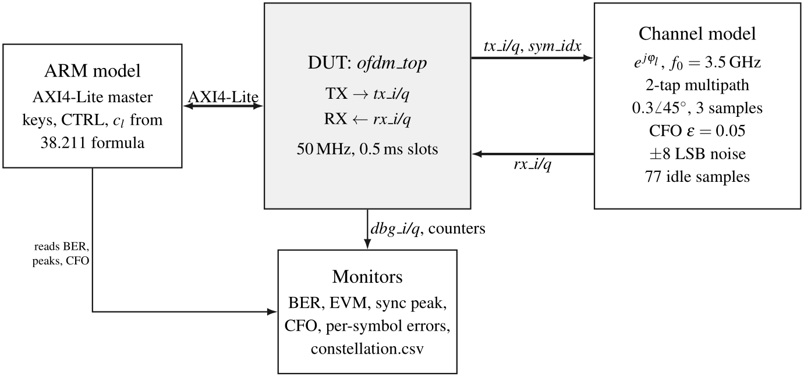
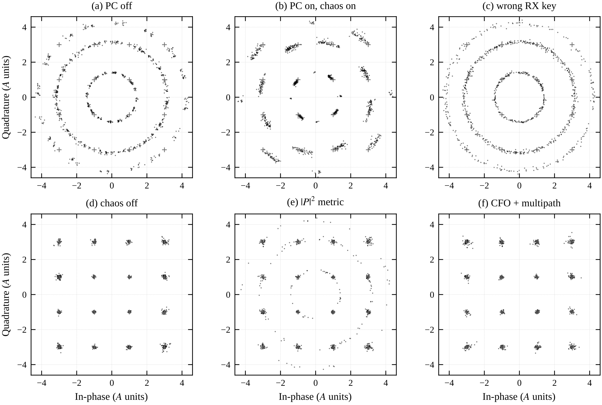

# Verification

Verification has three levels. Each RTL result has a matching model prediction and, where one exists, an analytical one.

| Level | What | Where | Runs in CI |
| --- | --- | --- | --- |
| Unit (RTL) | FFT → IFFT round trip against the decision margin | `tb/tb_fft_core.v` | yes (Icarus) |
| System (RTL) | 6 functional tests + real-time playout check | `tb/tb_ofdm_top.v` + `tb/channel_model.v` | yes (Icarus, non-blocking) |
| Model | 26 unit tests: FFT vs NumPy, rounding, Gray map, golden PC coefficients, LS theory, CFO accuracy, key-stream properties, RTL/model table consistency | `tests/` | yes (pytest) |
| Static | Verilator lint of the synthesizable RTL | `make lint` | yes |



## System testbench

The testbench plays the role of the ARM processor and of the measuring instruments:

- **Configuration.** An AXI4-Lite master task writes the 128-bit keys. It computes the 14 coefficients with the same formula as `sw/pc_coef.c` and writes them, then reads them back.
- **Channel.** `channel_model.v` applies, in order:
  1. the NR up-conversion phase φ_l of each symbol (f0 = 3.5 GHz);
  2. optional 2-tap multipath [1, 0.3e^(jπ/4)] at 3 samples;
  3. optional CFO ε = 0.05;
  4. integer uniform noise `$random % 9` (−8 … +8 LSB, σ = 4.9, SNR ≈ 38.2 dB).
- **Measurement per test** (`measure` task):
  1. wait `fl` slots (the flush);
  2. pulse `CTRL[3]` to clear the BER counters;
  3. run `n` slots;
  4. read `BER_BITS`, `BER_ERRS`, `SYNC_PEAK0/1` and `CFO_EST` over AXI, and print them.
- **EVM monitor.** On every `dbg_valid` it accumulates the squared distance to the nearest 16-QAM level and prints EVM = √(Σerr/Σref). It also writes the first 1024 points after each clear to `constellation.csv` (`test,I,Q`).
- **Per-symbol error monitor.** In tests that expect no errors, it prints every OFDM symbol that contains bit errors: time, symbol index in the slot, lock count.

| Test | CTRL | Configuration | Pass criterion |
| --- | --- | --- | --- |
| 1 | 0x35 | chaos on, phase compensation off | bit errors expected |
| 2 | 0x37 | chaos on, phase compensation on | BER = 0 |
| 3 | 0x37 | RX key differs in one bit | BER ≥ 10 % |
| 4 | 0x33 | chaos off, compensation on | BER = 0 |
| 5 | 0x77 | paper metric \|P(d)\|² (`metric_sel`) | BER = 0 |
| 6 | 0x37 | CFO 0.05 + multipath, CFO correction + equaliser | BER = 0 |
| - | - | TX playout | no underflow, slot starts aligned |

## How to run

```sh
make sim-fft          # Icarus: FFT unit test
make sim-top          # Icarus: system regression -> build/tb_top.log, build/constellation.csv
make vivado-sim       # Vivado xsim, batch (same testbench)
python experiments/plot_rtl_constellation.py build/constellation.csv
```

In the Vivado GUI: add `rtl/*.v` as design sources and `tb/*.v` as simulation sources, set `tb_ofdm_top` as the simulation top, then run `relaunch_sim` and `run all`. The constellation dump is written to `<project>.sim/sim_1/behav/xsim/constellation.csv`.

## Results

### Original RTL (100 MHz, 64-bit key, quadrant rotation): all tests passed

| Test | Bits / errors | BER | EVM |
| --- | --- | --- | --- |
| 1 | 13 280 / 6115 | 0.460 | 25.02 % |
| 2 | 19 936 / 0 | 0 | 1.18 % |
| 3 | 13 280 / 6845 | 0.515 | 1.19 % |
| 4 | 13 280 / 0 | 0 | 1.18 % |

### Updated RTL (this repository), one-slot flush: 3 tests failed

| Test | Bits / errors | BER | EVM | Sync peak / CFO est. | Result |
| --- | --- | --- | --- | --- | --- |
| 1 | 12 768 / 5738 | 0.449 | 26.67 % | 126 / 0.0000 | OK |
| 2 | 19 936 / 1194 | 5.99e-2 | 14.53 % | 126 / 0.0001 | **FAIL** |
| 3 | 13 280 / 6571 | 0.495 | 26.18 % | 126 / 0.0001 | OK |
| 4 | 13 280 / 0 | 0 | 3.07 % | 126 / 0.0000 | PASS |
| 5 | 13 280 / 227 | 1.71e-2 | 6.00 % | 563 117 / 0.0001 | **FAIL** |
| 6 | 13 280 / 252 | 1.90e-2 | 3.21 % | 106 / 0.0500 | **FAIL** |

TX playout: no underflow or alignment error, 20 slots locked. The decoded points of this run are in [`results/rtl/constellation_one_slot_flush.csv`](../results/rtl/constellation_one_slot_flush.csv).



EVM per OFDM symbol after each counter clear, reproduced with `plot_rtl_constellation.py`:

| Test | Symbol 1 | 2 | 3 | 4 | 5 | 6 | 7 | 8 |
| --- | --- | --- | --- | --- | --- | --- | --- | --- |
| 2 | 34.9 | 4.5 | 7.7 | 10.8 | 14.5 | 17.8 | 21.4 | 24.9 |
| 4 | 3.0 | 3.0 | 2.9 | 2.8 | 3.0 | 2.8 | 3.0 | 2.8 |
| 5 | 29.3 | 3.0 | 2.8 | 3.0 | 3.1 | 2.7 | 3.1 | 3.2 |
| 6 | 6.4 | 2.8 | 2.9 | 2.8 | 2.9 | 2.8 | 3.0 | 3.3 |

## Known issues

1. **Test-transition errors (Tests 2, 5, 6).** The receiver lags the input by more than one symbol. With a one-slot flush, the counters are cleared while the slot in which CTRL changed is still being decoded: see symbol 1 of Tests 2 and 5. In Test 2, phase compensation was switched on mid-symbol, which biases the slot-averaged CFO estimate. That shows up as EVM growing by about 3 % per symbol. The testbench now flushes two slots. **The two-slot regression has not been confirmed yet**, so the CI system job is non-blocking until it is.
2. **EVM ≈ 3 % with the equaliser** is expected. It is the 8.2 dB noise enhancement of the single-symbol LS estimate (√6.56 × 1.2 % ≈ 3.1 %); see [methodology](methodology.md).
3. **Not synthesised.** Resource and timing figures are analytical estimates (`make synth` produces the real reports).
4. **Simulator portability.** The testbench has been run in Vivado xsim. The Icarus and Verilator CI jobs are new, so their first runs may need small portability fixes.
